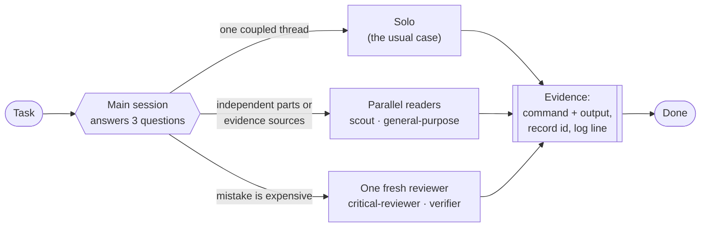

<div align="center">

# Adaptive orchestration for Claude Code

**Let the main session decide, per task, whether to work alone or build a team of subagents.**

Rules for `CLAUDE.md`, four lean agent definitions, a guard hook, and the A/B kit and honest numbers behind them.

[](LICENSE)


[How it works](#how-it-works) · [Results](#results-read-this-first) · [Install](#install) · [Guard hook](#guard-hook) · [Benchmark kit](#benchmark-kit) · [Українською](#українською)

</div>

---

## Why

Most multi-agent setups for Claude Code are a fixed pipeline: plan → code → review → verify, on every task. That is slow on small tasks and still misses the point on the big ones.

The numbers from one owner's **692 real sessions** say where the time actually goes:

- **25% needed rework**, and the most common cause was a result nobody had proven.
- **Only ~7%** of sessions split into independent parts. One coupled thread is the normal case.
- Rework is concentrated: incidents (42%), ports from a sibling (41%) and fixes (35%) — not questions or deploys.

So instead of a pipeline, this repo gives the main session a way to **route each task itself** and attach a helper only where it pays.

## How it works

The main session is the router. No router agent, no mandatory stages. Before starting, it answers three questions in one or two lines:

| # | Question | What it decides |
|---|---|---|
| 1 | **What would prove this is done?** | The evidence to collect before saying "done": a failing-then-passing test, a log line, a live probe, a record id. |
| 2 | **What can run at once?** | Whether anything is truly independent: parts of the work, or sources of evidence (logs, DB, code, external system). |
| 3 | **What is expensive to get wrong?** | Where a fresh reviewer or verifier earns its cost — and nowhere else. |



An agent is added **only** for one of four reasons:

| Reason | Example |
|---|---|
| **Noisy output** | Logs, dumps and wide reads come back as a 25-line summary instead of flooding the context. |
| **Breadth** | An audit too wide for one pass: parallel readers per area. |
| **Fewer tools** | A reviewer that physically cannot edit. |
| **Fresh eyes** | A reviewer that never saw the author's reasoning, only the diff. |

A subagent on the same task gives no smarter answer and starts cold. Parallelism mostly buys thoroughness, not speed.

<details>
<summary><b>Default plan per task type</b></summary>

| Task | Usually needs |
|---|---|
| Incident, "why did X happen" | Gather logs, database and external state in parallel; name a cause only with a record id or log line |
| Port a pattern from a sibling | Read the source first; copy it, add no new logic; parity check against the sibling |
| Fix | Reproduce first with a failing test or probe; on critical code one independent reviewer, at most one re-check |
| Data, report, page | Solo, no verifier by default; parallel per data group if big; check numbers against the source |
| Live test | Solo; read the result back from the real system |
| Deploy, ops | Solo; re-read the real state afterwards |
| Feature | One thread; agents per part only for independent parts, roughly over 3000 changed lines |
| Audit, inventory | Parallel readers per area |
| Question, status | Solo; short, plain words |

</details>

<details>
<summary><b>Roles, models and effort</b></summary>

Model and effort are always set explicitly in the call — an omitted model silently inherits the most expensive one.

| Role | Agent type | Model / effort |
|---|---|---|
| Collect, list, grep, dump | `scout` | haiku / low |
| Read, trace, inventory, docs research | default `general-purpose` (`Explore` only to locate code) | sonnet / medium; opus / medium on critical paths |
| Write ordinary code, mirror a pattern, tests | default `general-purpose` | sonnet / medium |
| Write critical code | default `general-purpose` | opus / medium |
| Review an ordinary diff | `reviewer` | sonnet / medium |
| Review a critical diff | `critical-reviewer` | opus / medium |
| Refute claims and findings | `verifier` | opus / medium |

Writers in one repository each get `isolation: "worktree"`. Reviewers get the diff, not the author's summary.

</details>

<details>
<summary><b>Other rules in the set</b></summary>

- **Done means proven.** The report quotes the command and its output, or the record id and log line.
- **Never a serial chain.** Don't wait on an agent while an independent step is left.
- **Bound the review.** Explicit criteria, "report only gaps that affect correctness, skip style". One review, then one re-check of the fix diff only.
- **Brief with paths, not file contents**, and ask for a short return (~25 lines, no code or diffs).
- **A finding from an agent is a claim** until verified; anything unchecked is marked "not verified".
- **When completeness matters**, pair a reader with a mechanical sweep and diff the two lists.

Full text: [`config/CLAUDE.orchestration.md`](config/CLAUDE.orchestration.md).

</details>

## Results: read this first

> [!IMPORTANT]
> **This is not proven to beat one plain Claude Code session.** Every number below is **one run** per task and arm, on one owner's real work (Opus 5.5, October 2026). It shows direction, not a precise measurement. A gap under about one point is noise.

Latest test — current rules vs. one plain session, run at the same time, same CLI version, base commit, skills and memory, labels hidden until grading ended:

| Task | Arm | Score | Time | Tokens | Agents | Worst defect |
|---|---|---|---|---|---|---|
| Fix on a money path | **Current rules** | **7.75** | 28.5 min | 2.00M | 1 reviewer | MEDIUM |
| | One session | 7.25 | **18 min** | **1.20M** | — | **HIGH** |
| Triage of a validator's findings | Current rules | 8.8 | 14.8 min | 1.37M | — | — |
| | One session | 8.8 | 14.1 min | 1.23M | — | — |

**What that means**

- ⚖️ **Triage: a tie.** The rules chose not to start any agents and matched the plain session.
- 🛡️ **Money fix: the review is the difference.** It removed the only HIGH defect, at +10.5 minutes and +67% tokens.
- ⚡ **Broad audit (earlier version):** 6 parallel auditors scored 8 vs 6.5, about 1.4× faster at about 1.8× tokens. The current rules have not re-run it.
- ❌ **No solution in any arm was ready to merge.**
- ❓ **Not measured yet:** whether the rules reduce rework on real work.

Full tables, earlier versions, and the measurement mistakes made along the way: **[docs/RESULTS.md](docs/RESULTS.md)**.

## What's inside

```text
.
├── config/
│   ├── CLAUDE.orchestration.md   # the rules — paste into CLAUDE.md
│   └── settings.example.json     # hooks block for settings.json
├── agents/
│   ├── scout.md                  # haiku/low   — mechanical collection, no judgement
│   ├── reviewer.md               # sonnet/medium — read-only review, ordinary code
│   ├── critical-reviewer.md      # opus/medium — read-only review where mistakes are expensive
│   └── verifier.md               # opus/medium — tries to refute a batch of claims
├── hooks/
│   ├── guard-bash.py             # PreToolUse(Bash) guard
│   └── guard-bash.example.json   # shared checkouts + blocked hosts
├── benchmark/
│   ├── setup_arms.sh             # two blind config arms with a random mapping
│   ├── run_arm.sh                # headless run of one arm on one task
│   ├── score.py                  # wall time, deduped tokens, subagents per arm
│   ├── grader_brief_template.md  # one brief for every arm
│   └── classify_brief.md         # classify past sessions by type and rework
├── tests/test_guard.py           # 35 cases, runs the hook as Claude Code does
└── docs/
    ├── RESULTS.md                # every run, with caveats
    └── SOURCES.md                # what the rules are based on
```

## Install

**Back up `~/.claude/CLAUDE.md` and `~/.claude/settings.json` first.**

```bash
git clone https://github.com/byigorduvanov/claude-adaptive-orchestration
cd claude-adaptive-orchestration

mkdir -p ~/.claude/agents ~/.claude/hooks
cp agents/*.md ~/.claude/agents/
cp hooks/guard-bash.py ~/.claude/hooks/
cp hooks/guard-bash.example.json ~/.claude/hooks/guard-bash.json

python3 tests/test_guard.py   # expect: 35 cases, 0 failures
```

Then:

1. **Guard config** — edit `~/.claude/hooks/guard-bash.json` with your own shared checkouts and blocked hosts.
2. **Hook** — merge the `hooks` block from [`config/settings.example.json`](config/settings.example.json) into `~/.claude/settings.json`, keeping your other settings.
3. **Rules** — paste [`config/CLAUDE.orchestration.md`](config/CLAUDE.orchestration.md) into `~/.claude/CLAUDE.md`, and trim the task table to the kinds of work you actually do.
4. **Tune** — `critical-reviewer` is generic: add the failure modes of your own domain to it.

New sessions pick up `CLAUDE.md` automatically.

## Guard hook

A small `PreToolUse` hook for the few rules that have **no exceptions**:

| Blocks | Unless |
|---|---|
| `git push --force` / `-f` / `--force-with-lease` / `+branch` | the command is prefixed with `OWNER_APPROVED_FORCE_PUSH=1` after the owner said yes |
| `git add -A` / `.` / `--all` / `-u` inside a shared checkout | you stage named paths |
| `ssh` / `scp` / `sftp` / `rsync` to a blocked host | never |

Quoted text (commit messages, `echo`) is ignored, and `cd` / `git -C` are followed to find the real directory.

```console
$ echo '{"tool_input":{"command":"git push --force origin main"},"cwd":"/tmp"}' | python3 hooks/guard-bash.py
{"hookSpecificOutput": {"hookEventName": "PreToolUse", "permissionDecision": "deny",
 "permissionDecisionReason": "Force push: ask the owner first and wait for a yes. After that yes, prefix the command with OWNER_APPROVED_FORCE_PUSH=1."}}
```

> [!NOTE]
> It stops **accidents, not a determined agent**: the session can set the approval variable itself, and a differently written command can slip past the text matching. It fails open on any error. It uses `deny` because, in testing under `bypassPermissions`, an `ask` decision did not stop the command.

## Benchmark kit

Compare two configs on **your own** tasks, blind:

```bash
# run from the directory the task works in; KIT is your clone of this repo
AB=~/ab OLD_CONFIG=~/old-config NEW_CONFIG=~/.claude TASKS="fix triage" \
  zsh $KIT/benchmark/setup_arms.sh          # random a/b ↔ old/new mapping in KEY.txt

# write ~/ab/<task>/PROMPT.md, using {X} for the arm name, then:
AB=~/ab zsh $KIT/benchmark/run_arm.sh fix a
AB=~/ab zsh $KIT/benchmark/run_arm.sh fix b
AB=~/ab python3 $KIT/benchmark/score.py fix a b
```

- Both arms share one copy of skills and memory, so the rules are the only difference. Memory plugins are switched off: their search can hold the answer key.
- Grade every arm with the **same** [`grader_brief_template.md`](benchmark/grader_brief_template.md); [`classify_brief.md`](benchmark/classify_brief.md) classifies your past sessions to find where your rework is.
- Requires macOS and zsh (`cp -c` needs APFS). Runs use your Claude plan or API: one Opus run here took 12–36 minutes.

<details>
<summary><b>Measurement mistakes worth avoiding</b></summary>

- **Cut wall time at the report.** Reading the end of the transcript once turned a 26-minute run into "81 minutes".
- **Same grader brief for every arm.** The same solution went from 7.5 to 6.25 once graders ran their own probes.
- **Build the grader's fact list from data,** never from one arm's report.
- **Run both arms together,** with hidden labels.
- **Treat a gap under ~1 point as noise.** One config scored 6.25 and 7.25 on the same task.

</details>

## Sources

The rules lean on Anthropic's [When to use multi-agent systems](https://claude.com/blog/building-multi-agent-systems-when-and-how-to-use-them), [Claude Code best practices](https://code.claude.com/docs/en/best-practices) and [How we built our multi-agent research system](https://www.anthropic.com/engineering/multi-agent-research-system), plus Cognition's [Multi-Agents: What's Actually Working](https://cognition.com/blog/multi-agents-working). Two lines that shaped them most:

> "The primary benefit of parallelization is thoroughness, not speed." — Anthropic
>
> "Multi-agent systems work best today when writes stay single-threaded." — Cognition

Full list with notes: [docs/SOURCES.md](docs/SOURCES.md).

## Українською

**Що це.** Правила для Claude Code, за якими основна сесія сама вирішує під кожну задачу: працювати самій чи зібрати команду субагентів. Жодного фіксованого пайплайна — сесія відповідає на три питання (*що доведе, що зроблено? що може йти паралельно? де помилка дорога?*) і додає агента лише там, де він окупається.

**Що всередині.** Текст правил для `CLAUDE.md`, чотири агенти (`scout`, `reviewer`, `critical-reviewer`, `verifier`), хук, що блокує випадковий force-push і `git add -A` у спільних репозиторіях, та кит для сліпого A/B-порівняння конфігурацій на власних задачах.

**Чесно про результат.** Що схема краща за звичайну сесію — **не доведено**. На розборі даних — нічия. На грошовому фіксі незалежне рев'ю прибрало єдиний HIGH-дефект ціною +10 хвилин. На широкому аудиті паралельні агенти виграли (8 проти 6.5). Кожна цифра — один прогін. Деталі в [docs/RESULTS.md](docs/RESULTS.md).

## License

[MIT](LICENSE)
