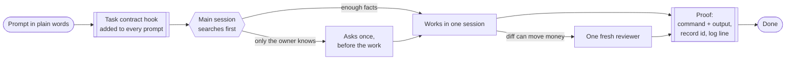

<div align="center">

# Adaptive orchestration for Claude Code

**How I run Claude Code: one session by default, proof before "done", and prompts that can stay short.**

My real rules, four lean agents, a prompt hook, reviewer evals, and the A/B kit and honest numbers behind them.

[](LICENSE)


[How it works](#how-it-works) · [Results](#results-read-this-first) · [Install](#install) · [Task contract hook](#task-contract-hook) · [Reviewer evals](#reviewer-evals) · [Benchmark kit](#benchmark-kit) · [Українською](#українською)

</div>

---

## Why

Most multi-agent setups for Claude Code are a fixed pipeline: plan → code → review → verify, on every task. That is slow on small tasks and still misses the point on the big ones.

The numbers from one owner's **692 real sessions** say where the time actually goes:

- **25% needed rework**, and the most common cause was a result nobody had proven.
- **Only ~7%** of sessions split into independent parts. One coupled thread is the normal case.
- Rework is concentrated: incidents (42%), ports from a sibling (41%) and fixes (35%) — not questions or deploys.

So there is no pipeline. One session does the work, proves the result, and adds a helper only where it pays. The owner writes the task in plain words: the rest comes from a hook.

## How it works



| Piece | What it does |
|---|---|
| [`hooks/task-contract.py`](hooks/task-contract.py) | Adds seven working rules to every prompt, so the owner does not have to write them |
| [`config/CLAUDE.md`](config/CLAUDE.md) | My global rules: one session by default, model and effort per agent, proof before "done" |
| [`agents/critical-reviewer.md`](agents/critical-reviewer.md) | A fresh read-only reviewer for diffs that can move money. It loads real failure classes from memory |
| [`evals/`](evals/run.py) and [`skills/reviewer-evals`](skills/reviewer-evals/SKILL.md) | Each confirmed incident becomes a failure class and a test of the reviewer |

An agent is added **only** for truly independent parts (a broad audit, a large migration), for noisy output returned as a short summary, or as a fresh reviewer. A subagent on the same task gives no smarter answer and starts cold.

## Results: read this first

> [!IMPORTANT]
> **This is not proven to beat one plain Claude Code session.** Every number below is **one run** per task and arm, on one owner's real work (Opus 5.5, October 2026). It shows direction, not a precise measurement. A gap under about one point is noise.

> [!NOTE]
> These runs tested the earlier, longer rules. The current short rules and the task contract hook have **not** been through this test.

Latest test — those rules vs. one plain session, run at the same time, same CLI version, base commit, skills and memory, labels hidden until grading ended:

| Task | Arm | Score | Time | Tokens | Agents | Worst defect |
|---|---|---|---|---|---|---|
| Fix on a money path | **Longer rules** | **7.75** | 28.5 min | 2.00M | 1 reviewer | MEDIUM |
| | One session | 7.25 | **18 min** | **1.20M** | — | **HIGH** |
| Triage of a validator's findings | Longer rules | 8.8 | 14.8 min | 1.37M | — | — |
| | One session | 8.8 | 14.1 min | 1.23M | — | — |

**What that means**

- ⚖️ **Triage: a tie.** The rules chose not to start any agents and matched the plain session.
- 🛡️ **Money fix: the review is the difference.** It removed the only HIGH defect, at +10.5 minutes and +67% tokens.
- ⚡ **Broad audit (earlier version):** 6 parallel auditors scored 8 vs 6.5, about 1.4× faster at about 1.8× tokens. The current rules have not re-run it.
- ❌ **No solution in any arm was ready to merge.**
- ❓ **Not measured yet:** whether the rules reduce rework on real work.

Full tables, earlier versions, and the measurement mistakes made along the way: **[docs/RESULTS.md](docs/RESULTS.md)**.

## What's inside

```text
.
├── config/
│   ├── CLAUDE.md                   # my global rules, minus private operations
│   ├── settings.example.json       # hooks block for settings.json
│   └── reviewer-memory.example.md  # failure classes for the reviewer
├── hooks/task-contract.py          # UserPromptSubmit: adds the task contract
├── agents/
│   ├── scout.md                    # haiku/medium — mechanical collection, no judgement
│   ├── reviewer.md                 # sonnet/high — read-only review, ordinary code
│   ├── critical-reviewer.md        # opus/medium — read-only review where mistakes are expensive
│   └── verifier.md                 # opus/medium — tries to refute a batch of claims
├── evals/
│   ├── run.py                      # runs the reviewer against known incidents
│   └── cases/example/case.json     # the case format
├── skills/reviewer-evals/SKILL.md  # incident → failure class → eval case
├── benchmark/                      # blind A/B kit for two configs
├── tests/test_task_contract.py     # 10 cases, runs the hook as Claude Code does
└── docs/
    ├── RESULTS.md                  # every run, with caveats
    └── SOURCES.md                  # what the rules are based on
```

## Install

**Back up `~/.claude/CLAUDE.md` and `~/.claude/settings.json` first.**

```bash
git clone https://github.com/byigorduvanov/claude-adaptive-orchestration
cd claude-adaptive-orchestration

mkdir -p ~/.claude/agents ~/.claude/hooks ~/.claude/skills ~/.claude/evals/critical-reviewer/cases
mkdir -p ~/.claude/agent-memory/critical-reviewer
cp agents/*.md ~/.claude/agents/
cp hooks/task-contract.py ~/.claude/hooks/
cp -R skills/reviewer-evals ~/.claude/skills/
cp evals/run.py ~/.claude/evals/critical-reviewer/
cp config/reviewer-memory.example.md ~/.claude/agent-memory/critical-reviewer/MEMORY.md

python3 tests/test_task_contract.py   # expect: 10 cases, 0 failures
```

Then:

1. **Hook** — merge the `hooks` block from [`config/settings.example.json`](config/settings.example.json) into `~/.claude/settings.json`, keeping your other settings.
2. **Rules** — take what fits from [`config/CLAUDE.md`](config/CLAUDE.md) into `~/.claude/CLAUDE.md`. It is written for trading code: adjust the money wording to your own expensive mistakes.
3. **Tune** — replace the failure classes with your own incidents.

New sessions pick up `CLAUDE.md` automatically.

## Task contract hook

A `UserPromptSubmit` hook that adds this to every prompt from the owner, and nothing to agent reports or app events:

```text
1. Done when: derive the proof yourself, state it first, quote it at the end, or say "not verified".
2. Bug or incident: prove the cause, then a failing test, then the fix.
3. Port: read the sibling first, copy without new logic, list the differences.
4. Missing facts: search first. Ask once, before the work, only what the owner alone knows.
5. Money bug: keep the failing test in the repo, with real numbers from the incident.
6. Big or vague task: interview the owner, write SPEC.md, build in a fresh session.
7. After two failed fixes in a row, stop and hand over a clean prompt for a new session.
```

Shortened here; [the script](hooks/task-contract.py) has the full text. Why a hook: `CLAUDE.md` is read at the start and fades in a long session, while the hook puts the rules next to each task. It costs no model call.

> [!NOTE]
> It is an instruction, not a lock: the model can still break it. I confirmed that the text reaches the model, not that rework went down.

**Tried and dropped:** a Stop hook for "code edited, nothing run after it". Replayed on 842 past turns, it would have fired on 4 of 47 turns with edits, none on trading code. Rework comes from weak proof, not from missing runs.

**Removed:** an earlier `PreToolUse` guard against force push. Those rules are now plain text in `CLAUDE.md`, so nothing blocks them in code. The guard is in the git history.

## Reviewer evals

Each confirmed incident becomes a failure class in the reviewer's memory and, when it can be reproduced from code, a test case. `python3 ~/.claude/evals/critical-reviewer/run.py` reviews each case without the memory file, since it contains the answers, and a small judge grades the report. My real cases hold private code, so only the format is here.

First run: **2 of 3 passed**, one run per case. The reviewer caught logic bugs in a new diff and missed a numeric trap that depends on price scale, so such bugs need a test with real numbers.

## Benchmark kit

Compare two configs on **your own** tasks, blind:

```bash
# run from the directory the task works in; KIT is your clone of this repo
AB=~/ab OLD_CONFIG=~/old-config NEW_CONFIG=~/.claude TASKS="fix triage" \
  zsh $KIT/benchmark/setup_arms.sh          # random a/b ↔ old/new mapping in KEY.txt

# write ~/ab/<task>/PROMPT.md, using {X} for the arm name, then:
AB=~/ab zsh $KIT/benchmark/run_arm.sh fix a
AB=~/ab zsh $KIT/benchmark/run_arm.sh fix b
AB=~/ab python3 $KIT/benchmark/score.py fix a b
```

- Both arms share one copy of skills and memory, so the rules are the only difference. Memory plugins are switched off: their search can hold the answer key.
- Grade every arm with the **same** [`grader_brief_template.md`](benchmark/grader_brief_template.md); [`classify_brief.md`](benchmark/classify_brief.md) classifies your past sessions to find where your rework is.
- Requires macOS and zsh (`cp -c` needs APFS). Runs use your Claude plan or API: one Opus run here took 12–36 minutes.

<details>
<summary><b>Measurement mistakes worth avoiding</b></summary>

- **Cut wall time at the report.** Reading the end of the transcript once turned a 26-minute run into "81 minutes".
- **Same grader brief for every arm.** The same solution went from 7.5 to 6.25 once graders ran their own probes.
- **Build the grader's fact list from data,** never from one arm's report.
- **Run both arms together,** with hidden labels.
- **Treat a gap under ~1 point as noise.** One config scored 6.25 and 7.25 on the same task.

</details>

## Sources

The rules lean on Anthropic's [When to use multi-agent systems](https://claude.com/blog/building-multi-agent-systems-when-and-how-to-use-them), [Claude Code best practices](https://code.claude.com/docs/en/best-practices) and [How we built our multi-agent research system](https://www.anthropic.com/engineering/multi-agent-research-system), plus Cognition's [Multi-Agents: What's Actually Working](https://cognition.com/blog/multi-agents-working). Two lines that shaped them most:

> "The primary benefit of parallelization is thoroughness, not speed." — Anthropic
>
> "Multi-agent systems work best today when writes stay single-threaded." — Cognition

Full list with notes: [docs/SOURCES.md](docs/SOURCES.md).

## Українською

**Що це.** Так у мене налаштований Claude Code. Одна сесія за замовчуванням, доказ перед словом «готово» і короткі промпти: правила додає hook, а модель сама шукає факти й питає лише те, що знає тільки власник.

**Що всередині.** Мої правила `CLAUDE.md` без приватних деталей, hook із контрактом задачі, чотири агенти, тести рецензента на реальних інцидентах і кит для сліпого A/B-порівняння конфігурацій.

**Чесно про результат.** Що ці правила кращі за звичайну сесію, **не доведено**. Поточні короткі правила і hook ще не проходили A/B, а зменшення переробок поки не виміряно. На грошовому фіксі незалежне рев'ю прибрало єдиний HIGH-дефект ціною +10 хвилин. Кожна цифра — один прогін. Деталі в [docs/RESULTS.md](docs/RESULTS.md).

## License

[MIT](LICENSE)
