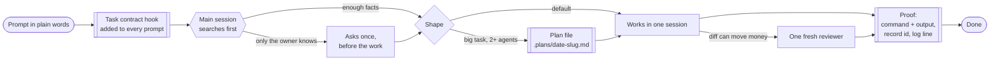

<div align="center">

# Adaptive orchestration for Claude Code

**How I run Claude Code: one session by default, proof before "done", and prompts that can stay short.**

My real rules, four lean agents, four small hooks, reviewer evals, a setup that maintains itself, and the blind A/B kit and numbers behind them.

[](LICENSE)


[How it works](#how-it-works) · [Results](#results) · [Install](#install) · [Hooks](#hooks) · [Self-improvement](#self-improvement-loop) · [Reviewer evals](#reviewer-evals) · [Benchmark kit](#benchmark-kit) · [Українською](#українською)

</div>

---

## Why

Most multi-agent setups for Claude Code are a fixed pipeline: plan → code → review → verify, on every task. That is slow on small tasks and still misses the point on the big ones.

The numbers from one owner's **692 real sessions** say where the time actually goes:

- **25% needed rework**, and the most common cause was a result nobody had proven.
- **Only ~7%** of sessions split into independent parts. One coupled thread is the normal case.
- Rework is concentrated: incidents (42%), ports from a sibling (41%) and fixes (35%) — not questions or deploys.

So there is no pipeline. One session does the work, proves the result, and adds a helper only where it pays. The owner writes the task in plain words and never says how to run it: the model picks the shape itself, and the rest comes from hooks.

## How it works

Every task message goes through one loop, assembled from Anthropic's own docs ([docs/anthropic-workflow.md](docs/anthropic-workflow.md), read 2026-11-17):

1. **Look first.** Read the request, then code, logs, memory and git. Name the check that will prove "done".
2. **Ask up front, never mid-task.** Only what the repo cannot answer, all in the first reply. Mid-task, the option you would mark "(Recommended)" is the answer: take it and list it as "decided X because Y".
3. **Pick the shape and say it in 1–2 lines:** what proves done, what runs at once, what is expensive to get wrong, and for research or a build the scope assumed (period, data, metric, repo).
4. **Small steps,** each followed by its check.
5. **Verify:** quote the command and its output; a fresh reviewer for a diff that can move money.
6. **Finish:** every "decided X because Y", lessons written down, processes stopped.



| Piece | What it does |
|---|---|
| [`config/CLAUDE.md`](config/CLAUDE.md) | My global rules: the loop above, model and effort per agent, plan file for big tasks only, proof before "done", Claude owns its skills and memory |
| [`hooks/task-contract.py`](hooks/task-contract.py) | Adds seven working rules to every owner prompt, so the owner does not have to write them |
| [`hooks/plan-gate.py`](hooks/plan-gate.py) | Blocks the second worker agent of a session until a plan file exists. One agent, and read-only agents, stay free |
| [`hooks/mem-health.py`](hooks/mem-health.py) | At session start, one line when the memory plugin's observer has lost its login; silent when healthy |
| [`agents/critical-reviewer.md`](agents/critical-reviewer.md) | A fresh read-only reviewer for diffs that can move money. It loads real failure classes from memory |
| [`evals/`](evals/run.py) and [`skills/reviewer-evals`](skills/reviewer-evals/SKILL.md) | Each confirmed incident becomes a failure class and a test of the reviewer |
| [`skills/memory-staleness-audit`](skills/memory-staleness-audit/SKILL.md) | A weekly lint of memory notes: old hosts and accounts stated as current, relative dates, overdue rechecks, passed `expires:` dates. It fixes or archives on its own and never deletes. The same script lints a markdown vault (`index.md`, subfolders, wikilinks) and can require a date and source on every fact and refuse card numbers and passwords |
| [`skills/setup-self-improve`](skills/setup-self-improve/SKILL.md) and [`hooks/self-improve-log.py`](hooks/self-improve-log.py) | The setup maintains itself: a hook logs which skills are used and which sessions ran, and a weekly run reads the week, turns the owner's corrections into skills and memory, archives dead skills, counts mid-task questions, and re-checks Anthropic's docs |
| [`skills/claude-context-budget-probe`](skills/claude-context-budget-probe/SKILL.md) | Measures what a fresh session loads before the first message (tool schemas, skills, `CLAUDE.md`, hooks) and proves a trim worked. Findings: [docs/context-budget.md](docs/context-budget.md) |
| [`assistant-vault/`](assistant-vault/CLAUDE.md) and [`skills/life-interview`](skills/life-interview/SKILL.md) | A personal assistant kept apart from code memory: a folder with its own `CLAUDE.md`, a markdown vault that opens in Obsidian, and a week-long interview that fills it, one life area a day, with a checklist of covered topics |

An agent is added **only** for truly independent parts (a broad audit, a large migration), for noisy output returned as a short summary, or as a fresh reviewer. A subagent on the same task gives no smarter answer and starts cold. Writers stay in one thread.

**Plan file, for big tasks only.** The model decides when a task is big (agents, many hours, more than one session, risk of losing context). It writes `.plans/<YYYY-MM-DD>-<slug>.md` at the workspace top: goal, what proves done, the owner's answers, every "decided X because Y", and steps marked `todo` / `doing` / `done: <proof>` / `blocked: <why>`. Agents read it and write long output next to it; a new or compacted session reads it before anything else. A short task stays on the app's task list.

## Results

Blind A/B on my real work: **this pipeline vs. vanilla Claude Code** (no `CLAUDE.md`, no hooks, no custom agents). Same model (Opus 5.5), skills, memory, CLI version and base commit; both arms ran at the same time. The graders never knew which arm was which, and confirmed every defect with their own probe tests.

### Half the defects on money code

| Money-path tasks (fix + 2 real features) | This pipeline | Vanilla Claude Code |
|---|---|---|
| MEDIUM defects shipped | **2** | 4 |
| LOW defects shipped | **3** | 6 |
| Tasks where it shipped fewer defects | **3 of 3** | 0 of 3 |

### Task by task

| Task | Score | Time | Tokens | Defects shipped |
|---|---|---|---|---|
| Large feature on a money path (replay of a real feature) | **7.3** vs 5.3 | **57.1 min** vs 106.9 min | **5.26M** vs 7.21M | **1 MEDIUM + 1 LOW** vs 2 MEDIUM + 3 LOW |
| Smaller feature feeding a money path (replay) | **9.5** vs 9.0 | 15.2 min vs 15.6 min | 1.54M vs **1.14M** | **none** vs 1 LOW |
| Fix of two bugs on a money path | **9** vs 8 | 22.5 min vs **17.4 min** | 3.01M vs **1.92M** | **1 MEDIUM + 2 LOW** vs 2 MEDIUM + 2 LOW |
| Triage of a trading validator's findings | 9 vs 9.5 | 18.2 min vs **13.0 min** | **3.48M** vs 4.56M | 0 vs 1 false claim |

*Pipeline first, vanilla second; bold marks the better arm.*

### Where the edge comes from

- 🛡️ **An independent money reviewer before "done".** Vanilla shipped defects the pipeline did not: a proxy contract that slips past the blacklist check, and a failed stop published as STOP LOSS and re-entered on a flat venue.
- 🏗️ **Big features finish faster.** On the large feature the pipeline was done in about half the time with 27% fewer tokens; vanilla spent the extra hour on extras the task did not ask for and a 31-minute self-review.
- ✂️ **Shorter sessions on real work.** The median session now needs 2 prompts instead of 4 (blind recheck of 177 real sessions before and after the switch).
- ⚖️ **Data triage: on par.** Both covered every finding with exact ids; vanilla was a few minutes faster there.

One run per task and arm. Every table, the grading briefs, the rework recheck of real sessions and all earlier rounds: **[docs/RESULTS.md](docs/RESULTS.md)**.

## What's inside

```text
.
├── config/
│   ├── CLAUDE.md                   # my global rules, minus private operations
│   ├── settings.example.json       # hooks block for settings.json
│   └── reviewer-memory.example.md  # failure classes for the reviewer
├── hooks/
│   ├── task-contract.py            # UserPromptSubmit: adds the task contract
│   ├── plan-gate.py                # PreToolUse(Agent): no second worker agent without a plan file
│   ├── mem-health.py               # SessionStart: one line when the memory observer lost its login
│   └── self-improve-log.py         # PreToolUse(Skill) + SessionEnd/Stop: usage and session logs
├── agents/
│   ├── scout.md                    # haiku/medium — mechanical collection, no judgement
│   ├── reviewer.md                 # sonnet/high — read-only review, ordinary code
│   ├── critical-reviewer.md        # opus/medium — read-only review where mistakes are expensive
│   └── verifier.md                 # opus/medium — tries to refute a batch of claims
├── evals/
│   ├── run.py                      # runs the reviewer against known incidents
│   └── cases/example/case.json     # the case format
├── skills/reviewer-evals/SKILL.md  # incident → failure class → eval case
├── skills/memory-staleness-audit/  # lint script + skill: find and mark stale memory notes
├── skills/life-interview/          # one interview day: ask, write dated facts, tick the checklist
├── skills/setup-self-improve/      # weekly: learn from sessions, update skills, archive dead ones
├── skills/claude-context-budget-probe/  # measure the context a fresh session starts with
├── assistant-vault/                # template: CLAUDE.md + empty vault (index, profile, people, areas, log, sources)
├── benchmark/                      # blind A/B kit for two configs
├── tests/
│   ├── test_task_contract.py       # 18 cases, runs the hook as Claude Code does
│   ├── test_plan_gate.py           # 14 checks: lone agent free, read-only exempt, reading a plan ≠ writing one
│   ├── test_mem_health.py          # 12 checks: health file, log tail, harmless WARN vs real failure
│   ├── test_self_improve_log.py    # 13 cases incl. malformed input and the 50 ms budget
│   └── test_collect.py             # 9 checks of the weekly run's collector on a fake HOME
└── docs/
    ├── anthropic-workflow.md       # Anthropic's guidance as one per-task loop, with quotes
    ├── RESULTS.md                  # every run, with caveats
    ├── SOURCES.md                  # what the rules are based on
    ├── SPEC-self-evolving-setup.md # the owner's decisions for the self-maintaining setup
    ├── best-practice-audit-2026-11.md  # the setup vs Anthropic's docs, read 2026-11-12
    └── context-budget.md           # what loads before the first message, and the trim
```

## Install

**Back up `~/.claude/CLAUDE.md` and `~/.claude/settings.json` first.**

```bash
git clone https://github.com/byigorduvanov/claude-adaptive-orchestration
cd claude-adaptive-orchestration

mkdir -p ~/.claude/agents ~/.claude/hooks ~/.claude/skills ~/.claude/evals/critical-reviewer/cases
mkdir -p ~/.claude/agent-memory/critical-reviewer
cp agents/*.md ~/.claude/agents/
cp hooks/*.py ~/.claude/hooks/ && chmod +x ~/.claude/hooks/*.py
cp -R skills/reviewer-evals skills/memory-staleness-audit skills/setup-self-improve skills/claude-context-budget-probe ~/.claude/skills/
cp evals/run.py ~/.claude/evals/critical-reviewer/
cp config/reviewer-memory.example.md ~/.claude/agent-memory/critical-reviewer/MEMORY.md

for t in tests/test_*.py; do python3 "$t"; done   # expect 66 cases in total, 0 failed
```

Then:

1. **Hooks** — merge the `hooks` and `permissions` blocks from [`config/settings.example.json`](config/settings.example.json) into `~/.claude/settings.json`, keeping your other settings. `mem-health.py` only makes sense with the claude-mem plugin; drop its `SessionStart` entry otherwise.
2. **Rules** — take what fits from [`config/CLAUDE.md`](config/CLAUDE.md) into `~/.claude/CLAUDE.md`. It is written for trading code: adjust the money wording to your own expensive mistakes.
3. **Tune** — replace the failure classes with your own incidents.

New sessions pick up `CLAUDE.md` automatically.

### Personal assistant vault (optional)

A separate folder for everyday tasks, so personal facts never mix with code memory:

```bash
mkdir -p ~/assistant/.claude/skills
cp -R assistant-vault/. ~/assistant/
cp -R skills/life-interview ~/assistant/.claude/skills/
python3 ~/.claude/skills/memory-staleness-audit/scripts/memory_lint.py ~/assistant/vault   # errors=0
```

The folder carries its own `.claude/task-contract.md`: the hook prints it there instead of the code contract, and `CLAUDE.md` says which global rules apply to an assistant and which are for code only.

Open `~/assistant/vault` in Obsidian as a vault, start Claude Code in `~/assistant` and say "interview me". Each day covers one area; answers go straight into the files as `- fact (YYYY-MM-DD, source)`.

## Hooks

All four are plain Python, make no model call, exit 0 on any error, and have their own tests.

### Task contract

A `UserPromptSubmit` hook that adds this to every prompt from the owner, and nothing to agent reports or app events:

```text
1. Choose the workflow yourself (solo, agents, plan file) per the loop in CLAUDE.md.
   Done when: derive the proof yourself, state it with the shape in your first line,
   quote it at the end, or say "not verified".
2. Bug or incident: prove the cause with a log line or record first, then a failing test, then the fix.
3. Port: read the sibling first, copy without new logic, list the differences.
4. Missing facts: search first. Ask once, before the work, only what the owner alone knows.
   Mid-task, never wait: the "(Recommended)" option is the answer; list it in the summary.
5. Money bug: keep the failing test in the repo, with real numbers from the incident.
6. Big or vague task: interview the owner, write the plan file, build in a fresh session that reads it.
7. After two failed fixes in a row, stop and hand over a clean prompt for a new session.
```

Shortened here; [the script](hooks/task-contract.py) has the full text. Why a hook: `CLAUDE.md` is read at the start and fades in a long session, while the hook puts the rules next to each task. A folder with its own `.claude/task-contract.md` (the assistant vault) gets that text instead.

**Context reminder.** The hook also reads the session transcript. Once the last request carried at least 350k tokens of context (`TASK_CONTRACT_CONTEXT_LIMIT`, default 350k), it tells the model to end its reply with a ready-to-paste prompt for a new session. Reason: in 14 days of my own logs, 77% of the main-session cost came from sessions that grew to 200–500k tokens, because every request re-reads the whole conversation. The limit started at 150k; I raised it to 350k on 2026-11-24.

> [!NOTE]
> It is an instruction, not a lock: the model can still break it.

**Tried and dropped:** a Stop hook for "code edited, nothing run after it". Replayed on 842 past turns, it would have fired on 4 of 47 turns with edits, none on trading code. Rework comes from weak proof, not from missing runs.

**Replaced:** an earlier `PreToolUse` guard script against force push. Force push is now an `ask` permission rule in [`settings.example.json`](config/settings.example.json), so Claude Code itself asks before it runs. Live probe 2026-11-17 (headless `claude -p` in bypassPermissions, throwaway repo with a local bare remote): asks for `--force`, `-f`, `--force-with-lease`, `+refspec` (quoted too), `--force` at the end, `git -C`/`git -c` forms and an env prefix; plain `push` and `--follow-tags` run. Two holes the probe found (`git -C w push -f`, `git -C w push +HEAD:main`) are closed. Known gaps: combined short flags (`-uf`) run without asking, and force set outside the command (aliases, `remote.*.push` config) is invisible to string rules; a commit message that contains `push --force` asks needlessly.

### Plan gate

A `PreToolUse` hook on `Agent`. The rule "big task → plan file" was easy to forget once agents were already running, so the second worker agent of a session is denied until the session has written a `.plans/…` file, with a reason telling the model what to write. It reads the session transcript, so it needs no state of its own.

- One agent is free: a quick search does not need a file. Agents started together in one message count together.
- Read-only and judging agents (Explore, scout, reviewers, verifier) never count.
- Only a real write counts as a plan: `Write`/`Edit`, or a shell redirect or `tee` into `.plans/`. `ls` or `cat` of the folder does not.

### Memory health

A `SessionStart` hook for the [claude-mem](https://github.com/thedotmack/claude-mem) plugin. Its background observer has lost its login more than once and stopped saving memories without any visible sign. The hook prints one context line when the observer's last error is an auth error newer than its last success, or when the log shows a login failure with nothing answered after it. A known harmless login warning that is followed by stored observations stays silent.

## Reviewer evals

Each confirmed incident becomes a failure class in the reviewer's memory and, when it can be reproduced from code, a test case. `python3 ~/.claude/evals/critical-reviewer/run.py` reviews each case without the memory file, since it contains the answers, and a small judge grades the report. My real cases hold private code, so only the format is here.

First run: **2 of 3 passed**, one run per case. The reviewer caught logic bugs in a new diff and missed a numeric trap that depends on price scale, so such bugs need a test with real numbers.

## Benchmark kit

Compare two configs on **your own** tasks, blind:

```bash
# run from the directory the task works in; KIT is your clone of this repo
AB=~/ab OLD_CONFIG=~/old-config NEW_CONFIG=~/.claude TASKS="fix triage" \
  zsh $KIT/benchmark/setup_arms.sh          # random a/b ↔ old/new mapping in KEY.txt

# write ~/ab/<task>/PROMPT.md, using {X} for the arm name, then:
AB=~/ab zsh $KIT/benchmark/run_arm.sh fix a
AB=~/ab zsh $KIT/benchmark/run_arm.sh fix b
AB=~/ab python3 $KIT/benchmark/score.py fix a b
```

- Both arms share one copy of skills and memory, so the rules are the only difference. Memory plugins are switched off: their search can hold the answer key.
- Grade every arm with the **same** [`grader_brief_template.md`](benchmark/grader_brief_template.md); [`classify_brief.md`](benchmark/classify_brief.md) classifies your past sessions to find where your rework is.
- Requires macOS and zsh (`cp -c` needs APFS). Runs use your Claude plan or API: one Opus run here took 12–36 minutes.

<details>
<summary><b>Measurement mistakes worth avoiding</b></summary>

- **Cut wall time at the report.** Reading the end of the transcript once turned a 26-minute run into "81 minutes".
- **Same grader brief for every arm.** The same solution went from 7.5 to 6.25 once graders ran their own probes.
- **Build the grader's fact list from data,** never from one arm's report.
- **Run both arms together,** with hidden labels.
- **Treat a gap under ~1 point as noise.** One config scored 6.25 and 7.25 on the same task.

</details>

## Sources

The rules lean on Anthropic's [When to use multi-agent systems](https://claude.com/blog/building-multi-agent-systems-when-and-how-to-use-them), [Claude Code best practices](https://code.claude.com/docs/en/best-practices) and [How we built our multi-agent research system](https://www.anthropic.com/engineering/multi-agent-research-system), plus Cognition's [Multi-Agents: What's Actually Working](https://cognition.com/blog/multi-agents-working). Two lines that shaped them most:

> "The primary benefit of parallelization is thoroughness, not speed." — Anthropic
>
> "Multi-agent systems work best today when writes stay single-threaded." — Cognition

Full list with notes: [docs/SOURCES.md](docs/SOURCES.md).

## Self-improvement loop

The owner does not want to tune the setup by hand, so it learns from the work:

| Piece | When | What |
|---|---|---|
| [`hooks/self-improve-log.py`](hooks/self-improve-log.py) on `PreToolUse` / `Skill` | every skill call | appends `{date, skill, cwd}` to `~/.claude/self-improve/skill-usage.jsonl` |
| the same hook on `SessionEnd` and `Stop` | end of a session, or each turn in the desktop app where sessions rarely end | appends `{date, cwd, transcript_path}` to `sessions.jsonl`, one line per session |
| in-session rule (`CLAUDE.md`, Skill Creator) | end of a task where the owner corrected the approach | writes the lesson in that turn: the skill that misled, or a feedback memory |
| [`skills/memory-staleness-audit`](skills/memory-staleness-audit/SKILL.md), a weekly scheduled task | Monday | lints memory and the vault, fixes stale notes in place, archives expired ones |
| [`skills/setup-self-improve`](skills/setup-self-improve/SKILL.md), a weekly scheduled task | Monday, after the memory audit | reads the week's transcripts as digests (sonnet readers), updates or creates skills (max 5), archives skills unused for 30+ days or past their `expires:` date, counts questions asked mid-task against the "ask up front" rule, re-checks Anthropic's docs, syncs this repo, reports with up to 4 questions as buttons |

**Skills and memory belong to Claude.** The owner does not read, curate or approve them. Claude creates, fixes, shortens and merges skills as it works, gives one-task skills and short-lived facts an `expires:` date, and "removing" always means moving the file to `~/.claude/archive/<date>/`, never deleting it. Each change gets one line in the session summary.

**What still waits for a yes:** deleting or disabling a rule, agent or hook; any edit to the global `CLAUDE.md`; any new permission prompt; and anything that would weaken a safety rule (money paths, deletion, force push, retired hosts). Those are proposals, never self-edits. The logging hook runs in about 25 ms. Typed `/skill` commands are counted from transcripts, not from a second hook.

The owner's original decisions for this loop: [docs/SPEC-self-evolving-setup.md](docs/SPEC-self-evolving-setup.md).

Where the setup stands against Anthropic's docs, row by row with links and dates: [docs/best-practice-audit-2026-11.md](docs/best-practice-audit-2026-11.md).

## Українською

**Що це.** Так у мене налаштований Claude Code. Одна сесія за замовчуванням, доказ перед словом «готово» і короткі промпти: правила додає hook, а модель сама шукає факти й питає лише те, що знає тільки власник.

**Як працює.** На кожне повідомлення з задачею — один цикл із документації Anthropic: спершу шукати в коді, логах, пам'яті й git; питати лише на початку і лише те, чого там немає; самій обрати форму роботи (соло, агенти, план-файл) і сказати її в 1–2 рядках; працювати малими кроками з перевіркою; закінчувати доказом і списком «вирішив X, бо Y». Посеред задачі модель не зупиняється на питанні: варіант, який вона позначила б «(Recommended)», і є відповіддю.

**Що всередині.** Мої правила `CLAUDE.md` без приватних деталей, чотири hook-и (контракт задачі; план-файл перед другим агентом; сигнал, що пам'ять перестала записуватись; лог використання скілів), чотири агенти, тести рецензента на реальних інцидентах, вимірювач контексту нової сесії і кит для сліпого A/B-порівняння конфігурацій.

**Самовдосконалення.** Скіли й пам'ять веде сам Claude: створює, виправляє, скорочує, а замість видалення переносить в архів. Щопонеділка `memory-staleness-audit` чистить пам'ять, а `setup-self-improve` читає тиждень сесій, перетворює виправлення власника на скіли й пам'ять, архівує мертві скіли, рахує питання посеред задачі і звіряє сетап із документацією Anthropic. Видалення правил, агентів і hook-ів, зміни глобального `CLAUDE.md` і будь-що, що послаблює правило безпеки, — лише після «так».

**Результати.** Сліпий A/B на моїй реальній роботі: цей пайплайн проти «ванільного» Claude Code. На трьох задачах із грошовим кодом (фікс і дві справжні фічі, відтворені з історії) пайплайн лишив удвічі менше підтверджених дефектів: 2 MEDIUM + 3 LOW проти 4 MEDIUM + 6 LOW, і менше в кожній із трьох задач. Велику грошову фічу він зробив за 57 хв проти 107, на 27% меншим обсягом токенів, з оцінкою 7.3 проти 5.3. Перевагу дає незалежний рев'юер грошового коду до слова «готово». На тріажі даних обидва на одному рівні. Реальні сесії стали коротшими: медіана 2 промпти замість 4. Усі таблиці в [docs/RESULTS.md](docs/RESULTS.md).

## License

[MIT](LICENSE)
